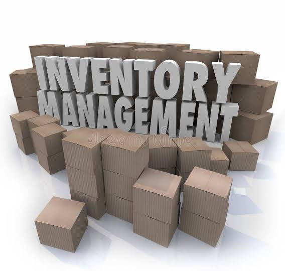

#Inventory Management
##Project Feature

**Python Inventory Application**
*Develop for ET0735*

-Calculate inventory value
-Check low stock
-Calculate restocking costs

[Python Documentation](https://docs.python.org/3/)

|Product|Price|Stock|
|------|------|------|
|Keyboard|$25.50|8|
|Mouse|$12.90|15|